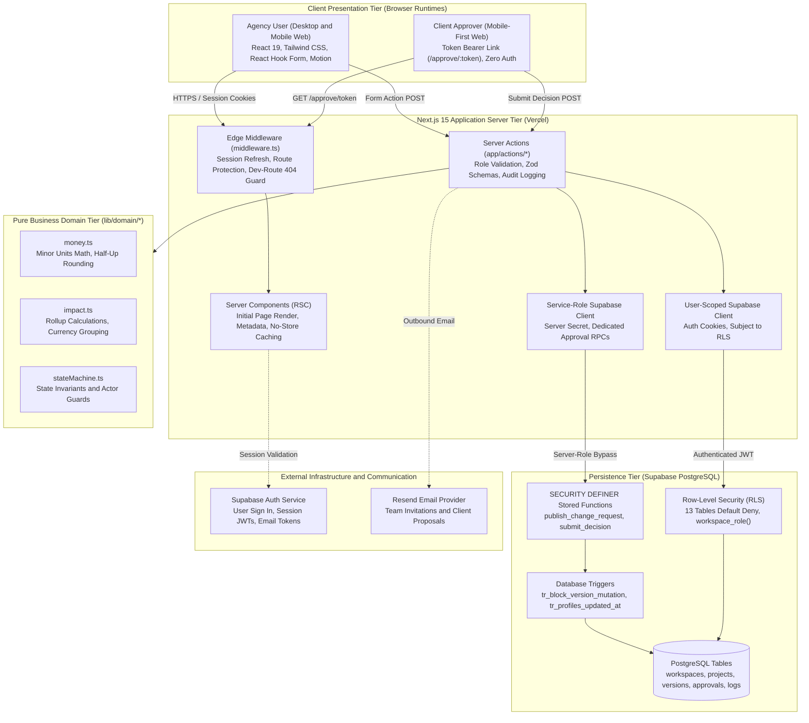
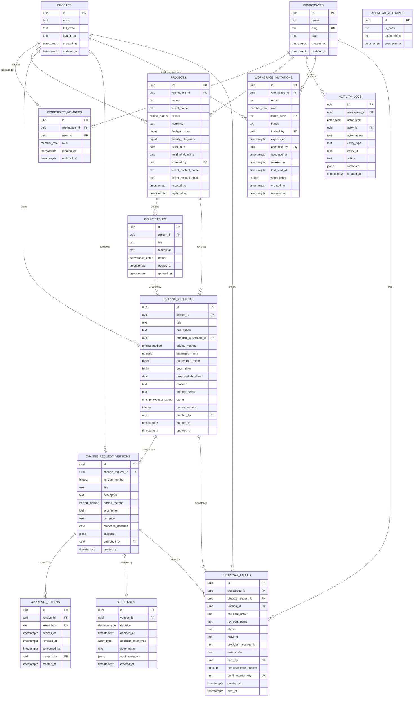
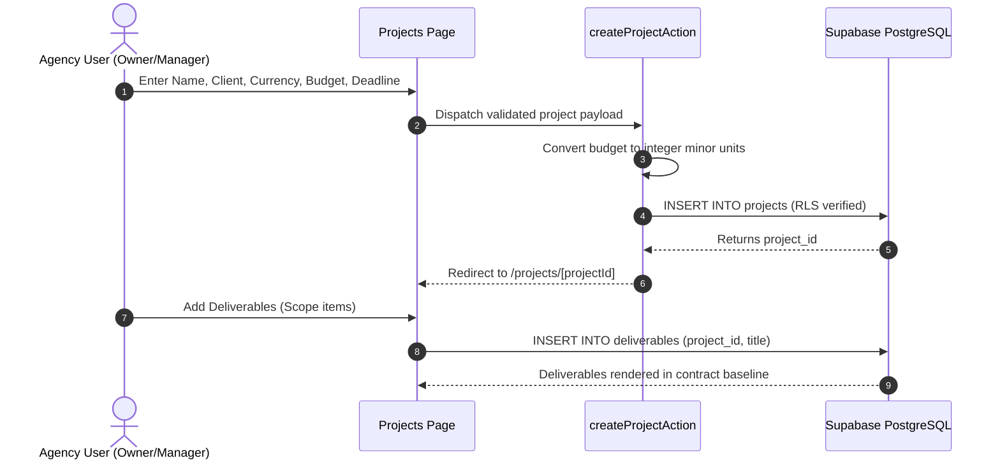
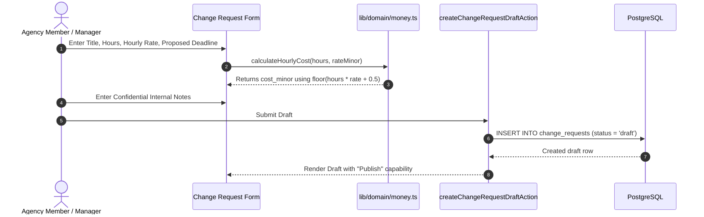
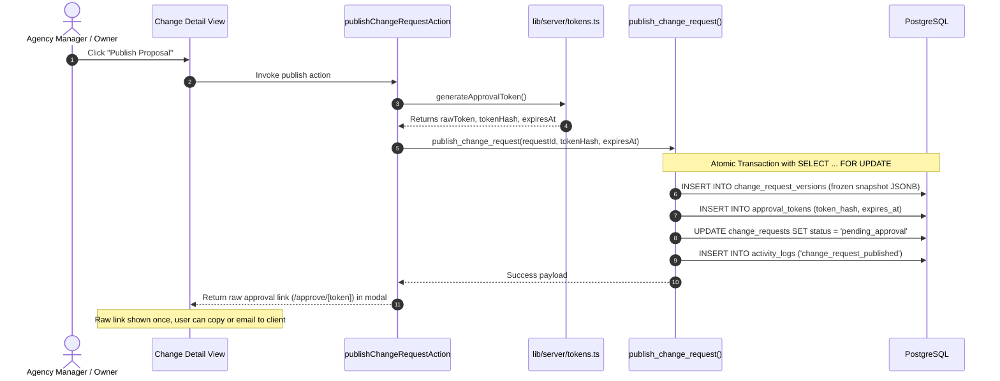
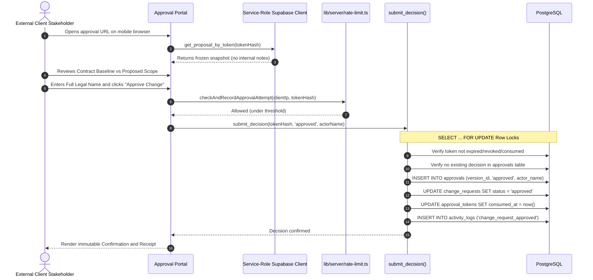
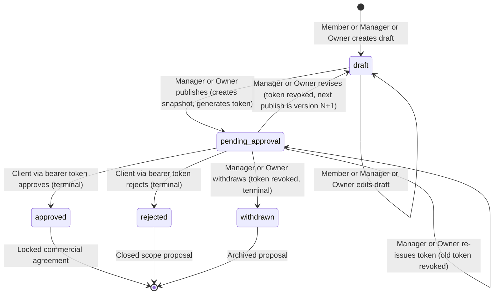
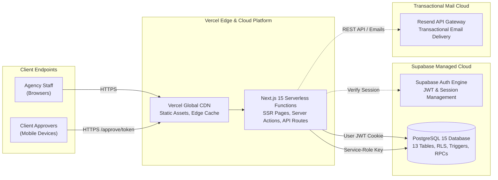

# ScopeGuard: Software Scope-Change Management System

**Academic Project Report & Technical Specification**  
**Course / Degree:** Final-Year Capstone Project / B.Tech Computer Science & Engineering  
**Project Title:** ScopeGuard — A Multi-Tenant Scope-Change Management and Real-Time Budget Protection Platform  
**Implementation Technology:** Next.js 15 (App Router), TypeScript, Tailwind CSS, Supabase (PostgreSQL 15 & SSR Auth), Resend  
**Hosting Environment:** Vercel (Edge & Serverless Node.js Runtime)  
**Source Code Repository:** [https://github.com/kirteebhat/scopeguard](https://github.com/kirteebhat/scopeguard)  
**Live Production Deployment:** [https://scopeguard-pearl.vercel.app](https://scopeguard-pearl.vercel.app)  
**Document Version:** 1.0.0 (Comprehensive Technical Report)  
**Date of Report:** 2026-10-19  

---

## Abstract

In commercial software development consultancies, digital agencies, and independent contracting teams, unbilled out-of-scope work—commonly termed "scope creep"—is a primary driver of margin erosion, delivery delays, and invoice disputes. Traditional scope-management procedures rely on formal contractual amendments, PDF change orders, or heavyweight digital signature suites, which introduce administrative friction that discourages billing for rapid, incremental scope adjustments. 

**ScopeGuard** is a full-stack, multi-tenant software-as-a-service (SaaS) web application designed to solve this problem by providing an itemized change request workflow and an unauthenticated, zero-friction client approval portal. Using cryptographically secure 256-bit URL-safe bearer tokens and immutable database snapshots, ScopeGuard enables agency project managers to draft, calculate, and publish change orders that external clients can approve or reject in seconds from any mobile device without logging in or downloading software. 

The architecture enforces strict separation between client components, Next.js 15 Server Actions, pure domain business logic, and PostgreSQL Row-Level Security (RLS). All financial values are calculated in integer minor units using deterministic half-up rounding, eliminating floating-point drift. This document serves as the comprehensive engineering design and implementation report for academic review.

---

## 1. Introduction & Background

### 1.1 Problem Definition & Industry Motivation
Software delivery is fundamentally iterative. During the development lifecycle of a contracted web or mobile application, client stakeholders frequently request adjustments, enhancements, or new features. In typical agency practice, these requests arrive through unstructured communication channels such as Slack, WhatsApp, email, or verbal discussions during status calls.

Agencies face a structural operational dilemma:
1. **Administrative Overhead:** Pausing development to draft formal legal contracts or DocuSign envelopes for small tasks (e.g., 4 to 8 hours of engineering work) stalls project momentum and creates client tension.
2. **Uncollected Revenue:** Because formal change requests are avoided, agencies absorb extra hours as "goodwill," resulting in unbilled scope expansion and margin collapse.
3. **End-of-Project Invoicing Disputes:** When an agency attempts to aggregate accumulated out-of-scope hours on a final reconciliation invoice without prior written sign-off, clients contest the charges, delaying final payment and damaging agency reputation.
4. **Timeline Drift & Accountability Void:** Extra deliverables naturally consume development sprints, delaying project delivery without establishing an updated contractual deadline, leaving engineering teams unfairly blamed for missed launch dates.

### 1.2 Core Hypothesis
The engineering hypothesis behind ScopeGuard states:

$$
\text{Friction-Free Approval Portal} + \text{Transparent Impact Modeling} \implies \text{Zero Unbilled Scope Creep}
$$

By decoupling client approval from formal user accounts (using secure, time-limited, unguessable cryptographic tokens) and presenting side-by-side impact comparisons (cost and deadline delta), clients will promptly authorize legitimate scope modifications without friction.

### 1.3 Project Objectives
- **Objective 1 (Commercial Baseline Integrity):** Establish structured project baselines defining contractual budget (in integer minor units), project currency (ISO 4217), deadline, and deliverables.
- **Objective 2 (Pure Domain Financial Engine):** Eliminate floating-point roundoff errors by processing all currency calculations in integer minor units (paise/cents) using deterministic half-up rounding.
- **Objective 3 (Version-Controlled Scope History):** Guarantee non-repudiation and auditability by capturing immutable version snapshots ($v_1, v_2, \dots$) upon publishing, locking them against database updates or deletions.
- **Objective 4 (Zero-Friction Client Experience):** Provide a dedicated, responsive mobile approval interface accessed via unguessable 256-bit URL-safe tokens, requiring zero registration or authentication.
- **Objective 5 (Atomic Concurrency Control):** Prevent double-submission, race conditions, and contradictory approvals using database-level row locking (`SELECT ... FOR UPDATE`).
- **Objective 6 (Multi-Tenant Security & Access Control):** Enforce Row-Level Security (RLS) on all database tables with default-deny policies, isolating workspaces and restricting administrative actions via role-based permissions (`owner`, `manager`, `member`).

### 1.4 Scope Boundaries

| In Scope (Implemented in Version 1.0 MVP) | Out of Scope (Future Work / Roadmap) |
|---|---|
| Multi-tenant agency workspaces and member hierarchy | Stripe payment deposit collection upon approval |
| Project and deliverable commercial baseline management | Automated webhook integrations with Jira, Linear, or Slack |
| Itemized hourly and fixed-fee change request drafting | Multi-currency automated foreign exchange (FX) live rates |
| Confidential internal notes hidden from client views | Cryptographic PKI legal digital signature certificates (eIDAS) |
| Pure domain calculation engine with half-up rounding | In-browser PDF export generator (CSV export is implemented) |
| 256-bit CSPRNG token generation and SHA-256 storage | Client two-factor email OTP verification on approval links |
| Public mobile approval portal with atomic row locking | Recurring automated cron background jobs for expired links |
| Immutable version snapshots protected by database triggers | Multi-language internationalization (English en-US default) |
| Workspace team invitations and proposal emails via Resend | Native mobile applications (iOS/Android) |
| RFC 4180 CSV export of approved scope changes | Advanced Gantt chart dependencies across deliverables |

---

## 2. Requirements Engineering

### 2.1 Functional Requirements (FR)

| Req ID | Requirement Description | Status | Verification & Evidence |
|---|---|:---:|---|
| **FR-01** | User authentication with email and password, password recovery, and email verification. | **Implemented** | [`app/actions/auth.ts`](app/actions/auth.ts), [`tests/unit/validation-auth.test.ts`](tests/unit/validation-auth.test.ts) |
| **FR-02** | Automatic user profile provisioning upon auth signup via database trigger. | **Implemented** | `supabase/migrations/20261011120000_initial_schema.sql` (`on_auth_user_created`) |
| **FR-03** | Multi-tenant workspace creation with unique URL-safe slug and owner assignment. | **Implemented** | `create_workspace` RPC, [`app/actions/workspace.ts`](app/actions/workspace.ts) |
| **FR-04** | Role-based authorization distinguishing `owner`, `manager`, and `member` permissions. | **Implemented** | RLS helper `workspace_role()`, [`tests/integration/rls.test.ts`](tests/integration/rls.test.ts) (28 test cases) |
| **FR-05** | Project management: create, edit, view baseline budget, currency, and original deadline. | **Implemented** | [`app/actions/projects.ts`](app/actions/projects.ts), [`tests/unit/projects.test.ts`](tests/unit/projects.test.ts) |
| **FR-06** | Deliverables management: add, edit, link to project, and track completion status. | **Implemented** | [`app/actions/deliverables.ts`](app/actions/deliverables.ts), [`tests/integration/projects-deliverables.test.ts`](tests/integration/projects-deliverables.test.ts) |
| **FR-07** | Change request drafting with hourly calculation (`hours * rate`) and fixed-fee options. | **Implemented** | [`lib/domain/money.ts`](lib/domain/money.ts), [`tests/unit/money.test.ts`](tests/unit/money.test.ts) |
| **FR-08** | Association of change requests with specific deliverables and proposed completion dates. | **Implemented** | [`lib/validation/change-requests.ts`](lib/validation/change-requests.ts), [`tests/unit/validation-domain.test.ts`](tests/unit/validation-domain.test.ts) |
| **FR-09** | Confidential agency notes captured in drafts but excluded from client-facing snapshots. | **Implemented** | `publish_change_request` RPC (omits `internal_notes` in JSONB snapshot) |
| **FR-10** | Publishing proposal generates immutable version snapshot $v_N$ and 14-day token. | **Implemented** | `publish_change_request` RPC, `tr_block_version_mutation` trigger |
| **FR-11** | Cryptographic token generation using 32 random bytes (base64url) and SHA-256 storage. | **Implemented** | [`lib/server/tokens.ts`](lib/server/tokens.ts), [`tests/unit/tokens.test.ts`](tests/unit/tokens.test.ts) |
| **FR-12** | Public approval portal (`/approve/:token`) displaying side-by-side commercial impact. | **Implemented** | [`app/approve/[token]/page.tsx`](app/approve/[token]/page.tsx), [`tests/e2e/client-approval.spec.ts`](tests/e2e/client-approval.spec.ts) |
| **FR-13** | Atomic decision recording (approve/reject) with self-declared legal name and row locking. | **Implemented** | `submit_decision` RPC, [`tests/integration/approval-concurrency.test.ts`](tests/integration/approval-concurrency.test.ts) |
| **FR-14** | Revising pending proposals revokes active token and reverts status to `draft`. | **Implemented** | `revise_change_request` RPC, [`tests/unit/state-machine.test.ts`](tests/unit/state-machine.test.ts) |
| **FR-15** | Withdrawing pending proposals revokes token and locks request in terminal `withdrawn`. | **Implemented** | `withdraw_change_request` RPC, [`tests/unit/state-machine.test.ts`](tests/unit/state-machine.test.ts) |
| **FR-16** | Re-issuing / regenerating approval token without incrementing version or altering draft. | **Implemented** | `regenerate_approval_token` RPC, [`app/actions/change-requests.ts`](app/actions/change-requests.ts) |
| **FR-17** | Rollup metrics derived exclusively from approved version snapshots. | **Implemented** | [`lib/domain/impact.ts`](lib/domain/impact.ts), [`tests/unit/impact.test.ts`](tests/unit/impact.test.ts) |
| **FR-18** | Workspace metrics grouped strictly by currency (no mixed-currency addition). | **Implemented** | `calculateWorkspaceRollup()` in [`lib/domain/impact.ts`](lib/domain/impact.ts) |
| **FR-19** | Team member invitation workflow via 7-day token links and strict email matching. | **Implemented** | `workspace_invitations` table, [`app/actions/invitations.ts`](app/actions/invitations.ts) |
| **FR-20** | Direct proposal email dispatch to client contact via Resend provider with rate limits. | **Implemented** | `proposal_emails` table, [`app/actions/proposal-emails.ts`](app/actions/proposal-emails.ts) |
| **FR-21** | Audit activity log recording actor, entity, action, and sanitized metadata. | **Implemented** | `activity_logs` table, [`tests/integration/project-rollup-and-activity.test.ts`](tests/integration/project-rollup-and-activity.test.ts) |
| **FR-22** | RFC 4180 compliant CSV export of approved project scope changes. | **Implemented** | [`app/api/projects/[projectId]/export-csv/route.ts`](app/api/projects/[projectId]/export-csv/route.ts) |
| **FR-23** | Automated background email reminder scheduler for expiring links. | **Not implemented** | Out of scope for MVP; no background scheduler configured. |
| **FR-24** | Automated online deposit payment collection via Stripe upon client approval. | **Not implemented** | Pricing plans are display-only launch hypotheses. |

### 2.2 Non-Functional Requirements (NFR)

| Req ID | Category | Requirement Specification | Compliance & Evidence |
|---|---|---|---|
| **NFR-01** | **Data Integrity** | Zero floating-point representation drift for monetary values. All amounts stored as integer minor units (`bigint`). | Validated by [`lib/domain/money.ts`](lib/domain/money.ts) and [`tests/unit/money.test.ts`](tests/unit/money.test.ts). |
| **NFR-02** | **Security** | Row-Level Security (RLS) enabled on 100% of tables with default-deny configuration. | 13/13 tables verified in `supabase/migrations/` and [`tests/integration/rls.test.ts`](tests/integration/rls.test.ts). |
| **NFR-03** | **Access Boundaries** | Service-role administrative key strictly restricted to server runtimes; throw if imported in browser. | Enforced by [`lib/env.ts`](lib/env.ts) (`typeof window !== "undefined"` check). |
| **NFR-04** | **Token Security** | Approval tokens generated with 256 bits of cryptographically secure entropy. Never store raw tokens in database. | Verified by [`lib/server/tokens.ts`](lib/server/tokens.ts) and [`tests/unit/tokens.test.ts`](tests/unit/tokens.test.ts). |
| **NFR-05** | **Rate Limiting** | Client approval portal protected against automated brute-force attacks via salted IP hash and token prefix throttling. | Verified in [`lib/server/rate-limit.ts`](lib/server/rate-limit.ts) and [`tests/unit/rate-limit.test.ts`](tests/unit/rate-limit.test.ts). |
| **NFR-06** | **Responsiveness** | Fluid mobile layout supporting viewport widths down to 360px without horizontal scroll overflow. | Verified via Playwright Mobile Chrome audits in [`tests/e2e/accessibility.spec.ts`](tests/e2e/accessibility.spec.ts). |
| **NFR-07** | **Accessibility** | Conform to WCAG 2.1 AA accessibility guidelines (contrast ratios, focus traps, screen reader landmarks). | Automated Axe-Core audit in [`tests/e2e/accessibility.spec.ts`](tests/e2e/accessibility.spec.ts) (10/10 checks passing). |
| **NFR-08** | **Immutability** | Published change request versions and recorded approvals must be permanently locked against updates or deletion. | Enforced by Postgres trigger `tr_block_version_mutation` in Migration 2. |
| **NFR-09** | **Privacy** | Sensitive metadata (raw client IP addresses, plaintext passwords, full emails in logs) must be sanitized or masked. | Salted SHA-256 IP hashing in `lib/server/rate-limit.ts`; email regex masking (`j***@example.com`) in audit logs. |

---

## 3. System Architecture & Component Interactions

### 3.1 Architectural Topology
ScopeGuard is architected as a modular, three-tier cloud application deployed on Vercel's serverless edge and Node.js runtimes, backed by Supabase Managed PostgreSQL.



### 3.2 Prose Layer Descriptions

1. **Client Presentation Tier (`app/`, `components/`):**
   Built with React 19 and Tailwind CSS. Forms utilize `react-hook-form` coupled with `@hookform/resolvers/zod` for instant client-side validation before server dispatch. Interactive feedback is handled with smooth, accessible animations via `motion` and icons from `lucide-react`. The client portal is specifically tuned for single-thumb mobile usage on viewports down to 360px.
2. **Next.js 15 Server Layer (`app/actions/`, `middleware.ts`):**
   Leverages Next.js 15 Server Actions (`"use server"`). The `middleware.ts` layer refreshes Supabase auth cookies, prevents unauthenticated access to `/dashboard`, `/projects`, and `/settings`, and enforces a hard `404 Not Found` on `/dev/*` routes when executing in production environments. On token pages (`/approve/*`, `/invite/*`), headers enforce `Cache-Control: no-store` and `X-Robots-Tag: noindex, nofollow`.
3. **Pure Domain Logic Tier (`lib/domain/`):**
   Framework-independent, zero-dependency business logic. Contains pure functions with 100% unit test coverage. This layer computes decimal conversions, half-up rounding, calendar date deltas, and state transition validation. No React, Next.js, or Supabase dependencies exist in this directory.
4. **Data Access Layer (`lib/data/`):**
   Server-side query isolation. Encapsulates Supabase query construction, joins, and error handling, guaranteeing that database specifics are cleanly decoupled from UI components and Server Actions.
5. **Database Persistence & Security Tier (`supabase/migrations/`):**
   PostgreSQL 15 hosted on Supabase. Row-Level Security (RLS) is enabled on all 13 tables with default-deny policies. Sensitive operations (such as publishing proposals, accepting invitations, and recording approvals) are implemented as transactional `SECURITY DEFINER` functions with locked `search_path = public, pg_temp` to prevent hijacking.

---

## 4. Database Schema & Data Models

### 4.1 Entity-Relationship (ER) Diagram

The real database schema encompasses **13 relational tables** derived from the 5 sequential migrations:



### 4.2 Database Enumerations (`ENUM` Types)
- **`member_role`:** `'owner'`, `'manager'`, `'member'`.
- **`project_status`:** `'active'`, `'completed'`, `'on_hold'`, `'archived'`.
- **`deliverable_status`:** `'pending'`, `'in_progress'`, `'completed'`, `'cancelled'`.
- **`pricing_method`:** `'hourly'`, `'fixed'`.
- **`change_request_status`:** `'draft'`, `'pending_approval'`, `'approved'`, `'rejected'`, `'withdrawn'`.
- **`decision_type`:** `'approved'`, `'rejected'`.
- **`actor_type`:** `'user'`, `'client_link'`, `'system'`.

### 4.3 Database Triggers & Constraints
1. **`tr_block_version_mutation`:** Applied on `change_request_versions`. Blocks any `UPDATE` or `DELETE` statement by raising an exception, guaranteeing immutable snapshots.
2. **`on_auth_user_created`:** Trigger on `auth.users` that executes `handle_new_user()` to populate `public.profiles`.
3. **`idx_workspace_single_owner`:** Unique partial index on `workspace_members (workspace_id) WHERE (role = 'owner')`, enforcing exactly one owner per workspace at the database engine level.
4. **`idx_workspace_invitations_active_email`:** Unique partial index on `workspace_invitations (workspace_id, email) WHERE (status = 'pending')`, guaranteeing at most one active invitation per email per workspace.
5. **`chk_project_dates`:** Enforces `original_deadline >= start_date` on `projects`.
6. **Currency & Non-Negative Minor Units:** All financial columns (`budget_minor`, `hourly_rate_minor`, `cost_minor`) enforce `CHECK (amount >= 0)`. Currencies enforce `CHECK (currency ~ '^[A-Z]{3}$')`.

---

## 5. Authentication, Authorization & Security Architecture

### 5.1 Authentication Flows
1. **Signup & Onboarding:** Handled via Supabase Auth `signUp`. Passwords require at least 8 characters with lowercase, uppercase, number, and special character. User profile is auto-created. If unconfirmed, an honest prompt allows resending verification. First-time login forwards to `/onboarding` to provision the workspace.
2. **Login & Session Refresh:** `loginAction` executes `signInWithPassword`. The `@supabase/ssr` middleware refreshes JWT cookies on every request.
3. **Password Reset:** `forgotPasswordAction` dispatches recovery email. The callback exchanges the code, establishes a recovery session, and routes to `/reset-password` where `resetPasswordAction` executes `supabase.auth.updateUser`.
4. **Open Redirect Mitigation:** Redirects read from query parameter `?next=` are validated through `getSafeRedirectUrl` ([`lib/validation/redirect.ts`](lib/validation/redirect.ts)), rejecting external domains and protocol-relative URLs (`//evil.com`).

### 5.2 Authorization Role Matrix

| Resource / Action | `owner` | `manager` | `member` | `client_link` (Bearer Link) |
|---|:---:|:---:|:---:|:---:|
| **Workspace Settings / Rename** | ✅ Allowed | ❌ Denied | ❌ Denied | ❌ Denied |
| **Delete Workspace** | ✅ Allowed | ❌ Denied | ❌ Denied | ❌ Denied |
| **Manage Members & Change Roles** | ✅ Allowed | ❌ Denied | ❌ Denied | ❌ Denied |
| **Invite Managers** | ✅ Allowed | ❌ Denied | ❌ Denied | ❌ Denied |
| **Invite Members** | ✅ Allowed | ✅ Allowed | ❌ Denied | ❌ Denied |
| **Create Projects & Deliverables** | ✅ Allowed | ✅ Allowed | ❌ Denied | ❌ Denied |
| **Create & Edit Change Drafts** | ✅ Allowed | ✅ Allowed | ✅ Allowed | ❌ Denied |
| **Publish Change Proposal** | ✅ Allowed | ✅ Allowed | ❌ Denied | ❌ Denied |
| **Revise & Withdraw Proposal** | ✅ Allowed | ✅ Allowed | ❌ Denied | ❌ Denied |
| **Regenerate Approval Token** | ✅ Allowed | ✅ Allowed | ❌ Denied | ❌ Denied |
| **Send Proposal Email to Client** | ✅ Allowed | ✅ Allowed | ❌ Denied | ❌ Denied |
| **Decide Proposal (Approve/Reject)** | ❌ Denied | ❌ Denied | ❌ Denied | ✅ Allowed (Via token) |

### 5.3 Cryptographic Token Security Architecture
Client approval links must be resilient against interception, guessing, and database leaks:
1. **Entropy:** Tokens are generated using Node.js `crypto.randomBytes(32)` (256 bits of cryptographically secure entropy) and encoded in URL-safe base64url characters.
2. **Memory-Only Raw Token:** The raw unhashed token is returned to the publishing user in memory for link copying or email dispatch. Raw tokens are **never** persisted to disk or logged.
3. **Deterministic SHA-256 Storage:** Only the 64-character lowercase SHA-256 hex digest (`token_hash`) is stored in `public.approval_tokens`. Direct `SELECT` on `token_hash` is revoked from client roles.
4. **14-Day Expiration & Single Decision:** Tokens expire after 14 days. Once a decision is recorded, the token is marked `consumed_at = now()`. The `approvals` table enforces `UNIQUE(version_id)`, guaranteeing that exactly one decision can ever be recorded for any given proposal version.

### 5.4 Database-Backed Rate Limiting
Public approval endpoints are protected from automated enumeration:
- Client IP addresses are hashed using a fixed secret salt (`RATE_LIMIT_SALT`) via `crypto.createHash("sha256").update(salt + ":" + ip).digest("hex")`.
- The `approval_attempts` table records the salted IP hash, the first 12 characters of the token hash (`token_prefix`), and a timestamp.
- Requests exceeding **30 attempts per IP** or **15 attempts per token** within a 10-minute sliding window receive an HTTP 429 rate limit response.
- In unmigrated or testing environments, the engine gracefully falls back to an in-memory sliding window.

---

## 6. Core System Workflows

### 6.1 Project Setup & Deliverables Definition


### 6.2 Change Request Drafting & Calculation


### 6.3 Proposal Publishing, Version Snapshotting & Link Issuance


### 6.4 Client Review & Atomic Decision Recording


### 6.5 Change Request State Transition Invariants
The state machine enforced in [`lib/domain/stateMachine.ts`](lib/domain/stateMachine.ts) governs all lifecycle transitions:



---

## 7. Domain Calculation Rules & Worked Examples

### 7.1 Precision Principles & Storage Standard
All monetary figures are stored in the database as integer minor units (e.g., paise for `INR`, cents for `USD`, `EUR`, and pence for `GBP`). Floating-point database data types (`FLOAT`, `DOUBLE PRECISION`) are strictly forbidden by architectural rule.

### 7.2 Hourly Pricing Formula & Rounding
Hourly scope pricing calculates estimated cost by multiplying estimated hours by the default hourly rate in minor units, applying deterministic half-up rounding:

$$
\text{cost\_minor} = \left\lfloor (\text{hours} \times \text{rate\_minor}) + 0.5 \right\rfloor
$$

```typescript
// Implemented in lib/domain/money.ts
export function calculateHourlyCost(hours: number, rateMinor: number): number {
  if (hours < 0 || rateMinor < 0) {
    throw new Error("Hours and rate must be non-negative");
  }
  return Math.floor(hours * rateMinor + 0.5);
}
```

#### Worked Example 1 (Standard Agency Task)
- **Scenario:** Change request adding payment gateway webhook retries.
- **Estimated Hours:** $12.5\text{ hours}$
- **Hourly Rate:** $₹1,500.00/\text{hr} = 150,000\text{ paise}$
- **Multiplication:** $12.5 \times 150,000 = 1,875,000.0\text{ paise}$
- **Half-Up Rounding:** $\lfloor 1,875,000.0 + 0.5 \rfloor = 1,875,000\text{ paise}$
- **Formatted Result:** **₹18,750.00**

#### Worked Example 2 (Fractional Boundary Rounding)
- **Scenario:** Micro-adjustment for UI typography audit.
- **Estimated Hours:** $3.33\text{ hours}$
- **Hourly Rate:** $\$85.50/\text{hr} = 8,550\text{ cents}$
- **Multiplication:** $3.33 \times 8,550 = 28,471.5\text{ cents}$
- **Half-Up Rounding:** $\lfloor 28,471.5 + 0.5 \rfloor = 28,472\text{ cents}$
- **Formatted Result:** **$284.72**

### 7.3 Project Financial Rollup Formulas
Financial totals roll up exclusively from immutable approved version snapshots:

1. **Original Contract Budget:**
$$
\text{original\_budget\_minor} = \text{projects.budget\_minor}
$$

2. **Approved Additional Charges:**
$$
\text{approved\_extra\_minor} = \sum_{v \in \text{approved\_versions}} v.\text{cost\_minor}
$$

3. **Revised Total Estimated Budget:**
$$
\text{revised\_budget\_minor} = \text{original\_budget\_minor} + \text{approved\_extra\_minor}
$$

4. **Revised Project Deadline:**
$$
\text{revised\_deadline} = \max\left(\{\text{original\_deadline}\} \cup \{v.\text{proposed\_deadline} \mid v \in \text{approved\_versions} \land v.\text{proposed\_deadline} \ne \text{null}\}\right)
$$

5. **Timeline Delta Days:**
$$
\Delta\text{days} = \text{daysBetween}(\text{revised\_deadline}, \text{original\_deadline})
$$

---

## 8. Testing & Quality Assurance Summary

ScopeGuard implements a rigorous four-layer testing hierarchy. All tests were executed in real-time on 2026-10-19:

| Test Level | Tooling | Files | Passed / Total | Key Areas Verified |
|---|---|:---:|:---:|---|
| **Static Typing** | TypeScript 5.7.3 (`tsc --noEmit`) | Project | **0 Errors** | Strict null checks, database types, action interfaces |
| **Linting** | ESLint 9.20.1 (`next lint`) | Project | **0 Errors** | Code conventions, unused variables, React hooks |
| **Unit Tests** | Vitest 3.0.5 | 20 files | **247 / 247 Passed** | Domain math, state transitions, Zod schemas, token entropy |
| **Integration Tests**| Vitest + `@electric-sql/pglite` | 11 files | **98 / 98 Passed** | Database migrations 1–5, 28 RLS policies, concurrency locks |
| **End-to-End Tests** | Playwright 1.50.1 + Axe-Core | 11 files | **18 / 22 Executed Passed** | Smoke tests (2/2), WCAG AA accessibility (10/10), dev 404 (2/2) |

### Real Vitest Automated Test Execution Output
```text
Test Files  31 passed (31)
     Tests  345 passed (345)
  Duration  33.86s
```

*For complete test logs, individual test suite breakdowns, and known failure analysis, refer to [`TESTING.md`](TESTING.md).*

---

## 9. Deployment Architecture

ScopeGuard is deployed in a modern JAMstack / Serverless topology combining Vercel, Supabase, and Resend.



---

## 10. Limitations & Future Scope

### 10.1 Verified System Limitations
1. **Bearer Link Trust Model:** Public approval links operate as unguessable bearer secrets. The approving client self-declares their name without biometric or hardware-backed identity verification.
2. **Email Delivery Acknowledgment:** The email service records `sent` upon acceptance by the Resend REST API; delivery receipts, opens, and spam bounces are not ingested via webhooks.
3. **Database-Backed Attempt Rate Limiting:** Throttling checks execute SQL queries against `approval_attempts` rather than utilizing distributed edge memory (e.g. Upstash Redis).
4. **Display-Only Pricing Tiers:** Subscription plans (`Free`, `Pro`, `Agency`) are non-functional launch hypotheses without an integrated Stripe billing engine.

### 10.2 Future Scope & Roadmap
- **Roadmap P1:** Two-factor client email OTP verification before granting access to `/approve/:token`.
- **Roadmap P1:** Automated background email notifications for pending proposals approaching their 14-day expiry.
- **Roadmap P2:** Stripe Checkout integration allowing agencies to require upfront deposit payments before scope approval is finalized.
- **Roadmap P2:** Webhook dispatchers sending real-time approval events into Slack channels, Linear tickets, or Jira backlogs.
- **Roadmap P2:** Dynamic foreign exchange (FX) engine to enable aggregate portfolio metrics across heterogeneous currencies.

---

## 11. Conclusion

ScopeGuard demonstrates that eliminating friction from the client change-order workflow provides a viable, scalable technical solution to the problem of agency scope creep. By engineering pure domain calculation rules, enforcing strict Row-Level Security across all 13 database tables, preserving immutable version snapshots, and implementing 1-click tokenized mobile approvals, the system establishes transparent commercial boundaries between agencies and clients. 

All core functional and non-functional requirements have been validated through static analysis, strict typechecking, 345 automated unit and integration tests, and live production deployment on Vercel.

---

## 12. References & Appendix

### 12.1 Technical References
1. **Next.js 15 Documentation:** Vercel App Router Architecture. [https://nextjs.org/docs](https://nextjs.org/docs)
2. **Supabase Documentation:** Row-Level Security, Database Functions & SSR Auth. [https://supabase.com/docs](https://supabase.com/docs)
3. **PostgreSQL Documentation:** Concurrency Control, Explicit Locking, and Triggers. [https://www.postgresql.org/docs/current/explicit-locking.html](https://www.postgresql.org/docs/current/explicit-locking.html)
4. **Zod Documentation:** TypeScript-First Schema Validation. [https://zod.dev/](https://zod.dev/)
5. **Resend API Reference:** Transactional Email Service. [https://resend.com/docs/api-reference/introduction](https://resend.com/docs/api-reference/introduction)
6. **Tailwind CSS Documentation:** Utility-First CSS Framework. [https://tailwindcss.com/docs](https://tailwindcss.com/docs)

### 12.2 Academic & Project Glossary
- **CSPRNG:** Cryptographically Secure Pseudorandom Number Generator (`crypto.randomBytes`).
- **Minor Units:** Smallest integer denomination of a currency (e.g., paise for INR, cents for USD).
- **RLS:** Row-Level Security, a PostgreSQL engine feature restricting database rows accessible by a given session.
- **RPC:** Remote Procedure Call; in Supabase, stored PostgreSQL functions invoked via `.rpc()`.
- **SECURITY DEFINER:** PostgreSQL function attribute causing the function to execute with the privileges of the creator rather than the caller.
- **Scope Creep:** The gradual, uncontrolled expansion of project scope without adjustments to time, cost, and resources.
- **Version Snapshot:** An immutable JSONB freeze of change request parameters captured at the instant of publishing.
