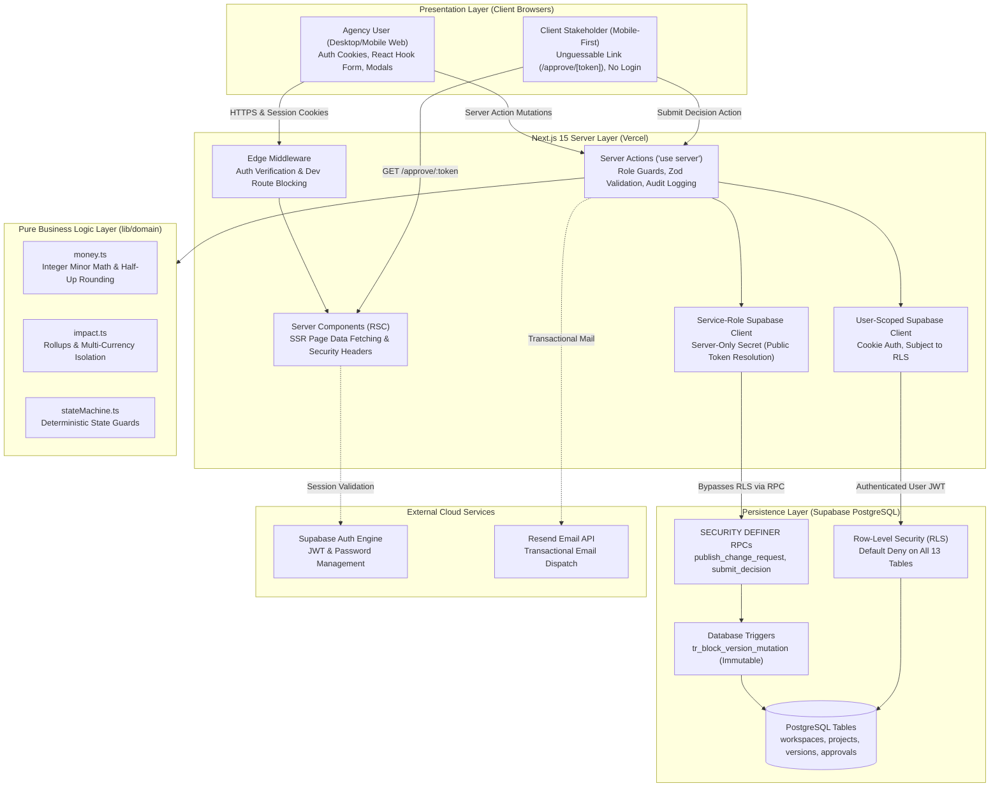

# ScopeGuard

> **Client-approved scope change management & real-time contract budget protection for software agencies.**

ScopeGuard is an open-source, multi-tenant B2B SaaS platform engineered for software consultancies, digital agencies, and independent contractors to eliminate unbilled scope creep. When a client requests modifications beyond the initial contract baseline, ScopeGuard enables agency teams to draft itemized estimates (hourly or fixed), preview the commercial impact while safeguarding confidential internal notes, and publish a secure, mobile-friendly 1-click approval link. Once approved by the client, project budget baselines and workspace dashboard metrics automatically update from immutable database snapshots.

---

## 1. Problem Statement & Solution

### Problem Hypothesis
Software consultancies, digital agencies, and freelance technical teams frequently suffer from margin erosion, unbilled overruns, and timeline drift because scope additions are requested and agreed upon informally (e.g., via Slack, email, or video calls). Traditional change-order processes require cumbersome contracts, PDF generation, or heavy e-signature tools (e.g., DocuSign), which introduces administrative friction that discourages billing for micro-adjustments. When agencies attempt to invoice for accumulated changes at project conclusion without prior written agreement, payment disputes and damaged client relationships follow.

### The ScopeGuard Solution
ScopeGuard removes administrative friction through a structured workflow:
1. **Contract Baseline Definition:** Establish projects with client names, ISO currencies, baseline budgets in integer minor units, and agreed-upon completion deadlines.
2. **Itemized Scope Change Drafting:** Draft changes linked to specific deliverables with transparent hourly (hours $\times$ rate) or fixed estimates, proposed deadline adjustments, and confidential internal notes.
3. **One-Click Public Approval Portal:** Publish proposals as immutable version snapshots associated with cryptographically secure, 14-day URL-safe bearer tokens (`/approve/[token]`). Clients review side-by-side contract vs. change comparisons and record an atomic approval or rejection in seconds without creating an account or downloading an app.
4. **Immutable Financial Rollups:** Project and workspace analytics derive exclusively from approved snapshot versions, ensuring historical accuracy and preventing double-counting or draft tampering.
5. **Team Collaboration & Notification:** Invite agency members with role-based access control (`owner`, `manager`, `member`) and deliver proposals directly to client contacts via transactional email.

---

## 2. Feature Implementation Status

The table below classifies the current implementation status of all features based on direct codebase inspection and automated test execution:

| Feature / Capability | Category | Status | Verification & Implementation Evidence |
|---|---|:---:|---|
| **Multi-Tenant Workspaces** | Core Identity | **Implemented** | Supabase Auth, profiles auto-creation trigger, `workspaces`, `workspace_members`, `create_workspace` RPC. |
| **Hierarchical Roles (`owner`, `manager`, `member`)** | Authorization | **Implemented** | RLS policies on all 13 tables, `workspace_role()` helper, and server action `requireRole` guards. |
| **Projects & Deliverables Management** | Commercial Baseline | **Implemented** | Full CRUD in [`app/actions/projects.ts`](app/actions/projects.ts) and [`deliverables.ts`](app/actions/deliverables.ts). Integer minor budget storage. |
| **Change Request Drafting** | Scoping Engine | **Implemented** | Hourly (hours $\times$ rate) and fixed fees, deliverable linking, proposed deadlines, private internal notes. |
| **Pure Domain Calculation Engine** | Financial Math | **Implemented** | Pure functions in [`lib/domain/money.ts`](lib/domain/money.ts) and [`impact.ts`](lib/domain/impact.ts). Deterministic half-up rounding (`floor(hours * rate + 0.5)`). |
| **Multi-Currency Isolation** | Financial Math | **Implemented** | Strict currency isolation per project. Workspace rollups grouped strictly by currency without cross-currency summation. |
| **Immutable Version Snapshots** | Version Control | **Implemented** | `change_request_versions` table with database trigger `tr_block_version_mutation` blocking UPDATE and DELETE. |
| **Cryptographic Token Hashing** | Security | **Implemented** | 256-bit CSPRNG tokens (`crypto.randomBytes(32)` base64url). Raw token exists in memory only; database stores SHA-256 hash. |
| **Public Client Approval Portal** | External Sign-off | **Implemented** | Dedicated `/approve/[token]` page. Displays baseline vs proposed delta. Captures self-declared legal name. |
| **Atomic Concurrency & Anti-Tamper** | Database Locking | **Implemented** | `submit_decision` RPC utilizes `SELECT ... FOR UPDATE` row locks, preventing race conditions and double-submits. |
| **Proposal Revision & Withdrawal** | State Machine | **Implemented** | Revising revokes active token and reverts to `draft` (next publish = $v_{N+1}$); withdrawing permanently archives the proposal. |
| **Workspace Activity Audit Feed** | Compliance | **Implemented** | `activity_logs` table records actor type, entity ID, action, and sanitized metadata (IP hashes, masked emails). |
| **Workspace Team Invitations** | Team Collaboration | **Implemented** | 7-day token invitations (`workspace_invitations`), strict authenticated email match, Resend dispatch, daily limits (20/day). |
| **Send Proposal via Transactional Email** | Client Delivery | **Implemented** | Resend integration (`proposal_emails`), project client contact fields, rate limiting (5/hr, 60s cooldown), in-memory fallback. |
| **CSV Audit Export** | Reporting | **Implemented** | Route `/api/projects/[projectId]/export-csv` generates RFC 4180 CSV export of approved change requests. |
| **Database-Backed Rate Limiting** | Security | **Implemented** | `approval_attempts` table tracks salted IP hashes (`RATE_LIMIT_SALT`) and token prefixes (max 30/IP, 15/token per 10 min). |
| **Dev Previews & Health Diagnostics** | Tooling | **Implemented** | `/dev/components`, `/dev/email-preview`, `/api/dev/auth-health` (strictly blocked with 404 in production). |
| **Automated Link Expiry Background Jobs** | Automation | **Not implemented** | No background scheduler or cron jobs configured; expiration evaluated dynamically at resolution time. |
| **Client Two-Factor OTP Verification** | Authentication | **Not implemented** | Approval portal uses bearer token identity with self-declared legal name; 2FA email OTP scheduled for Roadmap P1. |
| **Command Palette (`cmdk`)** | UI/UX | **Not implemented** | No command palette package installed; application uses standard navigation. |
| **Theme Switcher (Dark Mode Toggle)** | UI/UX | **Not implemented** | Clean, accessible light-mode palette only; no theme toggle code present. |
| **Stripe Scope Deposit Collection** | Payments | **Not implemented** | Pricing plans (`Free`, `Pro`, `Agency`) are display-only launch hypotheses; no active payment gateway connected. |
| **Webhook Integrations (Slack/Jira/Linear)** | Integrations | **Not implemented** | No outgoing webhook infrastructure implemented. |
| **Real-Time Live FX Rate Engine** | Financial Math | **Not implemented** | Multi-currency portfolios group figures by currency rather than converting currencies. |

---

## 3. Technology Stack

Derived directly from [`package.json`](package.json):

| Layer | Package / Tool | Exact Version | Description |
|---|---|---|---|
| **Web Framework** | `next` | `^15.1.7` | Next.js 15 App Router, React Server Components (RSC), and Server Actions |
| **UI Library** | `react`, `react-dom` | `^19.0.0` | React 19 core runtime |
| **Language** | `typescript` | `^5.7.3` | Strict TypeScript compiler configuration |
| **CSS & Design System** | `tailwindcss` | `^3.4.17` | Utility-first CSS framework with Tailwind forms and typography |
| **Icons** | `lucide-react` | `^0.475.0` | Accessible SVG icon collection |
| **Motion & Micro-interactions** | `motion` | `^14.3.0` | Declarative UI animations and transitions |
| **Database & Auth SDK** | `@supabase/ssr` | `^0.5.2` | Cookie-based SSR Auth client for Next.js App Router |
| **Supabase Client** | `@supabase/supabase-js` | `^2.49.1` | Postgres client and RPC execution engine |
| **Schema Validation** | `zod` | `^3.24.2` | Type-safe schema validation for forms, actions, and environment variables |
| **Form Management** | `react-hook-form` | `^7.54.2` | Client-side form state and validation |
| **Form Resolvers** | `@hookform/resolvers` | `^3.10.0` | Hook Form adapter for Zod validation schemas |
| **Transactional Email** | `resend` | `^6.34.1` | REST email dispatch for team invitations and proposals |
| **Test Runner** | `vitest` | `^3.0.5` | Fast unit and integration test runner (`vitest.config.ts`) |
| **Embedded Database Engine** | `@electric-sql/pglite` | `^0.5.8` | Real in-memory Postgres WASM for automated SQL and RLS tests |
| **End-to-End Testing** | `@playwright/test` | `^1.50.1` | Headless browser testing for desktop and mobile viewports |
| **Accessibility Testing** | `@axe-core/playwright` | `^4.14.0` | Automated WCAG AA accessibility audit integration |
| **Script Execution** | `tsx` | `^4.23.15` | TypeScript runtime for project utility scripts |
| **Linting & Formatting** | `eslint`, `prettier` | `^9.20.1`, `^3.5.1` | Static code analysis and formatting rules |

---

## 4. Architecture Overview

ScopeGuard implements strict architectural boundaries: client components never communicate directly with PostgreSQL; mutations flow through Server Actions and `SECURITY DEFINER` stored procedures governed by Row-Level Security (RLS).



---

## 5. Quick Start & Local Setup

### Prerequisites
- **Node.js:** v18.17.0+ or v20+ LTS (recommended)
- **Package Manager:** npm (v9+)
- **Database:** Supabase project (hosted or local CLI via Docker)

### Step 1: Clone Repository
```bash
git clone https://github.com/kirteebhat/scopeguard.git
cd scopeguard
```

### Step 2: Install Dependencies
```bash
npm install
```

### Step 3: Configure Environment Variables
Copy the template configuration file:
```bash
cp .env.example .env.local
```
Update `.env.local` with your configuration placeholders (see table in Section 6).

### Step 4: Apply Database Migrations
ScopeGuard contains 5 idempotent SQL migrations located in `supabase/migrations/`:
1. `20261011120000_initial_schema.sql` (Core tables: profiles, workspaces, members, projects, deliverables)
2. `20261011130000_change_requests_and_approvals.sql` (Change requests, immutable versions, tokens, approvals, logs)
3. `20261011140000_row_level_security.sql` (RLS policies, helper functions, permission revocations)
4. `20261018230000_workspace_invitations.sql` (Team invitation tables, functions, and email triggers)
5. `20261019000000_proposal_emails.sql` (Client contacts, proposal email logs, rate-limiting procedures)

Apply them sequentially via the Supabase Dashboard SQL Editor or via the Supabase CLI:
```bash
npx supabase db reset
```

### Step 5: Start Local Development Server
```bash
npm run dev
```
Open [http://localhost:3000](http://localhost:3000) (or configured port) in your browser.

---

## 6. Environment Variables

The application utilizes the following environment variables:

| Variable Name | Required | Realm | Default / Example Placeholder | Purpose |
|---|:---:|---|---|---|
| `NEXT_PUBLIC_SUPABASE_URL` | **Yes** | Client & Server | `https://your-project.supabase.co` | Hosted Supabase project URL |
| `NEXT_PUBLIC_SUPABASE_ANON_KEY` | **Yes** | Client & Server | `your-supabase-anon-key` | Browser-accessible anon key governed by RLS |
| `NEXT_PUBLIC_APP_URL` | **Yes** | Client & Server | `http://localhost:3000` | Canonical base URL for auth callbacks and links |
| `SUPABASE_SERVICE_ROLE_KEY` | **Yes** | **Server Only** | `your-supabase-service-role-key` | Backend secret key for public token operations |
| `RESEND_API_KEY` | No | Server Only | `re_your_resend_api_key_here` | Transactional email provider API key |
| `EMAIL_FROM` | No | Server Only | `ScopeGuard <notifications@scopeguard.agency>` | Outgoing sender identity |
| `RATE_LIMIT_SALT` | No | Server Only | `your_secret_rate_limit_salt_here` | Secret salt for client IP address hashing |

> [!WARNING]
> Never expose `SUPABASE_SERVICE_ROLE_KEY` or `RESEND_API_KEY` to client-side bundles or `NEXT_PUBLIC_*` variables. `lib/env.ts` enforces an active security boundary that throws an immediate exception if invoked from browser runtimes.

---

## 7. Development & Quality Commands

Only commands defined in [`package.json`](package.json) are supported:

```bash
# Run local development server
npm run dev

# Execute ESLint static analysis
npm run lint

# Run strict TypeScript compilation check
npm run typecheck

# Run Vitest unit & integration test suite (includes in-memory PGlite RLS tests)
npm run test

# Run Next.js production build
npm run build

# Start production server
npm run start

# Run Playwright end-to-end browser tests
npm run test:e2e
```

---

## 8. Deployment Summary

ScopeGuard is configured for zero-config deployment on Vercel:
- **Build Command:** `next build` (`npm run build`)
- **Install Command:** `npm install`
- **Output Directory:** `.next`
- **Framework Preset:** Next.js
- **Live Deployment URL:** [https://scopeguard-pearl.vercel.app](https://scopeguard-pearl.vercel.app)
- **Repository URL:** [`https://github.com/kirteebhat/scopeguard`](https://github.com/kirteebhat/scopeguard)

For comprehensive step-by-step instructions on Vercel deployment, environment variable configuration, and Supabase Auth redirect settings, refer to [`SETUP_AND_DEPLOYMENT.md`](SETUP_AND_DEPLOYMENT.md).

---

## 9. Visual Interface & Screenshots

The screenshots below illustrate key application interfaces captured from the production environment:

| View / Workflow | Preview | Description & Asset Location |
|---|:---:|---|
| **Marketing Landing Page** | `docs/screenshots/01-landing.png` | Value proposition, interactive demo, and pricing hypothesis. |
| **User Sign Up** | `docs/screenshots/02-signup.png` | Agency registration and workspace auto-provisioning. |
| **User Login** | `docs/screenshots/03-login.png` | Secure credentials entry with reset recovery links. |
| **Agency Dashboard** | `docs/screenshots/post-upgrade/01-dashboard.png` | Real-time currency rollups, active change requests, and activity feed. |
| **Projects Overview** | `docs/screenshots/post-upgrade/02-projects.png` | Workspace project cards with baseline budgets and approved delta indicators. |
| **Project Details & Scope** | `docs/screenshots/post-upgrade/03-project-detail.png` | Contract financial baseline vs revised budget, deliverables list, and change log. |
| **Draft Change Request** | `docs/screenshots/post-upgrade/04-change-request-new.png` | Itemized change request editor with live calculation and confidential internal notes. |
| **Team Management & Invites** | `docs/screenshots/post-upgrade/05-settings-team.png` | Team member list, role selectors, and pending invitations management. |
| **Design System Components** | `docs/screenshots/04-dev-components.png` | Internal UI gallery (available in dev mode, blocked in production). |

---

## 10. Verified Limitations & Future Enhancements

In adherence to ScopeGuard's engineering honesty rules, the following capabilities are designated as current limitations:

1. **Bearer Link Identity:** Public approval links operate as unguessable shared secrets. Clients self-declare their name at decision time. Verified two-factor email OTP is planned for Roadmap P1.
2. **Database-Backed Rate Limiting:** Attempt counters are queried from the `approval_attempts` Postgres table. Edge Redis caching (e.g. Upstash) is planned for high-scale enterprise deployments.
3. **Email Delivery Guarantee:** Outgoing emails record a status of `sent` when accepted by the Resend REST API; webhook tracking for final inbox receipt or bounce events is not currently implemented.
4. **No Legal E-Signature Certificate:** ScopeGuard generates commercial approvals and audit trails. Estimates are explicitly disclaimed as *"Estimates, not binding quotes or legal e-signatures"*.
5. **Display-Only Pricing Tiers:** Subscription plans (`Free`, `Pro`, `Agency`) are displayed as market hypotheses without an active billing processor connection.

---

## 11. Complete Documentation Index

For in-depth technical analysis and operational guidance, refer to the accompanying documents:

- [`PROJECT_DOCUMENTATION.md`](PROJECT_DOCUMENTATION.md) - Complete engineering report written for final-year B.Tech CSE project evaluation, covering system requirements, architecture, database ER diagram, security models, state machines, and worked calculation examples.
- [`SETUP_AND_DEPLOYMENT.md`](SETUP_AND_DEPLOYMENT.md) - Step-by-step installation, hosted Supabase setup, Vercel deployment instructions, post-deployment verification checklist, and troubleshooting guide.
- [`TESTING.md`](TESTING.md) - Complete test suite documentation, real automated execution results from today's test runs, breakdown of all 31 test files and 345 passing tests, coverage summary, and known failure records.
