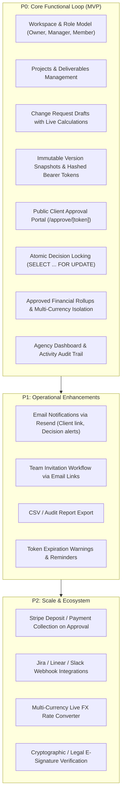

# ScopeGuard - Product Requirements Document (PRD)

---

## 1. Problem Statement (Hypothesis)

> **Hypothesis:** Software consultancies, digital agencies, and independent technical contractors experience substantial margin erosion and delivery delays because out-of-scope client requests are handled informally (via Slack, email, or calls) without immediate visibility into financial or timeline consequences and without friction-free formal sign-off.

### Core Problems Observed
1. **Unbilled Expansion ("Scope Creep"):** Small client requests accumulate over a project's lifecycle. Agencies fear client friction or administrative overhead when charging for incremental work, ultimately delivering unpaid work.
2. **Post-Project Invoicing Disputes:** When agencies do bill for accumulated extras at project completion without prior written agreement, clients contest invoices, resulting in delayed payments and damaged relationships.
3. **Timeline Drift & Accountability Gaps:** Adding deliverables shifts release dates, yet teams rarely establish a revised baseline deadline, leading to missed client expectations and blamed teams.
4. **Client Friction in Traditional Approvals:** Traditional change order workflows require formal contracts, PDFs, or e-signature software (e.g., DocuSign), creating friction that discourages micro-approvals for rapid adjustments.

---

## 2. Target Users & User Personas

| Persona | Role | Primary Needs & Pain Points |
|---|---|---|
| **Agency Founder / Owner** | Executive oversight | • Needs real-time visibility into approved extra charges vs. original budgets. • Wants to protect agency margins and eliminate uncollected billing. • Controls workspace settings, team access, and business configuration. |
| **Project / Account Manager** | Operational management | • Needs to rapidly draft change requests with clear cost and timeline estimates. • Wants a lightweight, professional way to get client sign-off without legal friction. • Needs an immutable audit trail when scope or dates are contested. |
| **Developer / Technical Contributor** | Delivery & scoping | • Needs clarity on what deliverables are in contract scope vs. out of scope. • Identifies scope creep during sprints and creates draft change proposals for review. |
| **External Client Stakeholder** | Decision maker / Approver | • Wants total transparency on cost and delivery date impacts before agreeing. • **Does not want to create an account, remember passwords, or navigate complex tools.** • Needs a 30-second mobile experience to review and approve/reject change requests. |

---

## 3. User Roles & Identity Model

### Internal Workspace Roles (Authenticated Users)
*Every authenticated agency user belongs to a workspace and holds one of three hierarchical roles:*
- **`owner`:** Complete authority over the workspace. Manages billing metadata, workspace settings, and member role assignments. Exactly one owner per workspace.
- **`manager`:** Operational authority. Can create and edit projects, create/edit/publish/revise/withdraw change requests, and view workspace analytics. Cannot modify workspace settings or ownership.
- **`member`:** Execution role. Can view authorized projects and create/edit **draft** change requests. Cannot publish proposals, withdraw proposals, edit project budgets, or manage team members.

### External Client Actor (`client_link`)
- **Not a workspace user:** The client is **never** registered in `workspace_members`.
- **Identity Model:** Clients access specific proposal versions via cryptographically secure, time-limited (14-day) bearer tokens.
- **Operational Non-Repudiation:** At decision time, the client enters a self-declared name (and optional email). The system records the name, timestamp, and salted/truncated IP hash.

---

## 4. Scope Categorization: P0 vs. P1 vs. P2

### P0 Scope (Mandatory MVP Core Loop)
1. **Workspace & Auth:** Next.js SSR authentication with Supabase Auth. Auto-provision profile on signup; create initial workspace.
2. **Project Setup:** Define projects with client name, contract baseline budget (integer minor units), currency (ISO 3-letter code), original deadline, and initial deliverables list.
3. **Change Request Drafting:** Form supporting hourly estimates (hours $\times$ hourly rate) or fixed charges, affected deliverable selector, proposed new deadline, and private internal notes.
4. **Pure Domain Engine:** Integer minor unit arithmetic, deterministic half-up rounding, live preview calculation, and state transition guards.
5. **Publish & Version Control:** Create immutable version snapshot ($v_1, v_2, \dots$), generate 14-day CSPRNG token, store SHA-256 hash, present copyable link modal.
6. **Public Client Approval Portal:** Dedicated `/approve/[token]` page with zero agency navigation. Clear comparison of original baseline vs. proposed change. Self-declared name capture. Atomic double-submit prevention.
7. **Revision & Withdrawal:** Revising a pending proposal revokes active tokens and returns the request to `draft`. Republishing creates version $N+1$.
8. **Rollup Metrics & Dashboard:** Projects and workspace dashboards calculate approved totals **exclusively** from approved version snapshots, strictly isolated by currency.
9. **Security & Accessibility:** Strict RLS default-deny on all tables; `SECURITY DEFINER` RPCs with fixed search path; WCAG AA compliance; mobile responsiveness at 360px.

### P1 Scope (Near-Term Roadmap)
- Outbound transactional emails (Resend integration) for sending links and notifying managers of approvals.
- Workspace member invitation flow with signed token links.
- Export change request history and audit logs to CSV.
- Automated link expiry reminder warnings for pending proposals.

### P2 Scope (Future Non-MVP Capabilities)
- Legal e-signature integration (DocuSign/HelloSign compliance).
- Automated payment deposit collection via Stripe Checkout upon proposal approval.
- Webhook notifications into Slack, Linear, or Jira.
- Real-time exchange rate engine to aggregate multi-currency portfolios.

---

## 5. Non-Goals (What ScopeGuard Is NOT)

To maintain architectural focus and delivery integrity, ScopeGuard explicitly rejects the following product scopes:
1. **Not a General Project Management Tool:** ScopeGuard does not track daily tasks, kanban boards, sprint backlogs, or burndown charts (use Linear/Jira).
2. **Not a Time Tracker:** ScopeGuard does not run live timers or timesheet submissions (use Harvest/Toggl). Hours are recorded as scoped estimates.
3. **Not an Invoicing / Tax Engine:** ScopeGuard does not issue GST/VAT tax invoices, calculate regional sales tax, or manage accounts receivable (use QuickBooks/Xero).
4. **Not a Legally Binding E-Signature Platform:** ScopeGuard does not generate cryptographic PKI certificates or qualify as an eIDAS/ESIGN compliant digital signature platform. It captures operational client sign-off.

---

## 6. Demo Success Criteria

The demo will be judged successful if the following end-to-end journey executes flawlessly:
1. **Zero Fake Data:** Every metric on the dashboard and project overview derives from real database rows.
2. **Live Scoping & Preview:** Agency user creates a change request; the calculation panel updates live (`12.5 hrs × ₹1,500 = ₹18,750`). The proposal preview confirms internal notes are omitted.
3. **Link Generation:** Publishing generates a valid token link with an explicit reminder that no email was dispatched.
4. **Unauthenticated Mobile Sign-Off:** The link is opened in an incognito window at 360px viewport width. Client submits approval with a self-declared name.
5. **Immediate Atomic Consistency:**
   - Agency refreshes project page: the project budget updates by exactly ₹18,750; revised deadline shifts to the approved date.
   - Client refreshes approval page: displays a calm, permanent "Already Approved" receipt. Submitting a duplicate request is blocked.
6. **Revision & Invalidation Proof:** A pending proposal is revised; the previous link immediately returns "Revoked / Superseded". Republishing generates a working Version 2.
