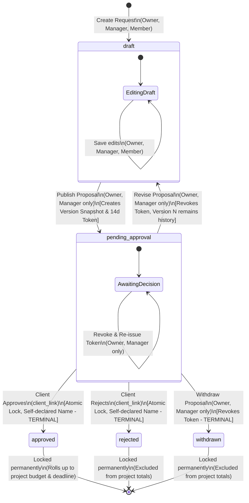

# ScopeGuard - Change Request State Machine Specification

---

## 1. Overview & Core Philosophy

The ScopeGuard change-request lifecycle is designed to eliminate ambiguity, race conditions, and disputed charges. 
The state machine strictly enforces that:
1. **Decisions are bound to an exact version snapshot:** A client never approves a mutable row; they approve an immutable version record ($v_1, v_2, \dots$).
2. **Terminal states are immutable:** Once an outcome (`approved`, `rejected`, `withdrawn`) is reached, no further transitions or edits are permitted. Subsequent requirements require a fresh change request.
3. **Revisions revoke active access:** Revising a proposal immediately revokes any active approval links, ensuring clients cannot sign off on superseded estimates.

---

## 2. Mermaid State Diagram



---

## 3. Permitted State Transitions

| From State | To State | Trigger / Action | Authorized Actors | Preconditions | Side Effects (DB, Versions, Tokens, Audit) |
|---|---|---|---|---|---|
| *(None)* | `draft` | Create change request | `owner`, `manager`, `member` | Project exists in user's active workspace. Title & description provided. | • Inserts row in `change_requests` with `status = 'draft'`.<br>• `current_version = NULL`.<br>• Logs `change_request_created`. |
| `draft` | `draft` | Update draft | `owner`, `manager`, `member` | Request is in `draft`. | • Updates mutable draft fields (pricing method, hours, rate, deadline, notes).<br>• Logs `change_request_updated`. |
| `draft` | `pending_approval` | Publish proposal | `owner`, `manager` | • Pricing method valid (hourly has hours $\ge 0$ & rate $\ge 0$; fixed has amount $\ge 0$).<br>• Proposed deadline $\ge$ project start date.<br>• Title non-empty. | • Atomically creates row in `change_request_versions` ($N = 1$ or previous $+ 1$).<br>• Freezes immutable JSONB snapshot of all fields.<br>• Generates 32-byte CSPRNG token; stores SHA-256 hash in `approval_tokens` (`expires_at = now() + 14d`).<br>• Updates `change_requests` (`status = 'pending_approval'`, `current_version = N`).<br>• Logs `change_request_published` (version $N$). |
| `pending_approval` | `pending_approval` | Re-issue link | `owner`, `manager` | Request is `pending_approval`. Active token lost or compromised. | • Marks existing token `revoked_at = now()`.<br>• Generates new 14-day token for the *same* version.<br>• Logs `approval_token_reissued`. |
| `pending_approval` | `draft` | Revise proposal | `owner`, `manager` | Request is `pending_approval`. | • Atomically marks active token `revoked_at = now()`.<br>• Reverts `change_requests.status = 'draft'`.<br>• Draft fields remain editable; previous version remains preserved.<br>• Next publish will create version $N+1$.<br>• Logs `change_request_revised`. |
| `pending_approval` | `withdrawn` | Withdraw proposal | `owner`, `manager` | Request is `pending_approval`. Agency retracts proposal. | • Atomically marks active token `revoked_at = now()`.<br>• Sets `change_requests.status = 'withdrawn'`.<br>• Terminal state reached.<br>• Logs `change_request_withdrawn`. |
| `pending_approval` | `approved` | Submit Client Approval | `client_link` (Bearer Token) | • Valid, unexpired (`expires_at > now()`), unrevoked token hash.<br>• Request is `pending_approval`.<br>• `approvals` table has no row for this `version_id`.<br>• Self-declared name $\ge 2$ characters.<br>• Row lock acquired (`SELECT ... FOR UPDATE`). | • Inserts row in `approvals` (`decision = 'approved'`, `actor_name`, audit metadata).<br>• Sets `change_requests.status = 'approved'`.<br>• Token marked consumed (`consumed_at = now()`).<br>• Terminal state reached.<br>• Approved version snapshot immediately rolls up into project budget & deadline.<br>• Logs `change_request_approved`. |
| `pending_approval` | `rejected` | Submit Client Rejection | `client_link` (Bearer Token) | • Same token validity, atomic locking, and self-declared name requirements as approval. | • Inserts row in `approvals` (`decision = 'rejected'`, `actor_name`, audit metadata).<br>• Sets `change_requests.status = 'rejected'`.<br>• Token marked consumed.<br>• Terminal state reached.<br>• Excluded from financial rollups.<br>• Logs `change_request_rejected`. |

---

## 4. Disallowed / Rejected Transitions & Rationale

| Attempted Transition | Actor | Why It Is Strictly Blocked | System Enforcement |
|---|---|---|---|
| `draft` $\rightarrow$ `pending_approval` | `member` | Team members are scoped to drafting. Publishing binds commercial terms and must be authorized by project managers or owners. | Application layer guard & Postgres RPC check. |
| `draft` $\rightarrow$ `approved` / `rejected` | Any | A draft has no immutable snapshot, no token, and has never been formally submitted to the client. | State machine validator and database constraints. |
| Direct Edit while `pending_approval` | Any | An active proposal represents an open offer to a client. Modifying figures under an active offer creates race conditions and disputes. | `change_requests` row blocked from UPDATE while `status != 'draft'`. Must invoke `revise` first. |
| `pending_approval` $\rightarrow$ `approved` (Expired Token) | `client_link` | Bearer links expire after 14 days to prevent stale pricing agreements after agency capacity or rates have changed. | SQL validation: `expires_at > now()`. Returns HTTP 410 / "Link Expired". |
| `pending_approval` $\rightarrow$ `approved` (Revoked Token) | `client_link` | If an agency revised or withdrew a request, the old link is invalidated immediately. | SQL validation: `revoked_at IS NULL`. Returns "Link Superseded". |
| `approved` $\rightarrow$ any state | Any | **Terminal State.** Approved change orders represent legally and commercially settled agreements. Tampering with approved records compromises accounting integrity. | Database trigger blocks UPDATE on requests in `approved` status. |
| `rejected` $\rightarrow$ any state | Any | **Terminal State.** Once a client declines, the proposal is closed. To propose altered terms, the agency must initiate a new change request. | Database trigger blocks UPDATE on requests in `rejected` status. |
| `withdrawn` $\rightarrow$ any state | Any | **Terminal State.** Withdrawn proposals are archived. Re-proposing requires a new change request. | Database trigger blocks UPDATE on requests in `withdrawn` status. |
| Concurrent Duplicate Decision | `client_link` | Rapid double-clicks or multiple open tabs could attempt to record duplicate approvals. | Postgres atomic transaction with `SELECT ... FOR UPDATE` and `UNIQUE(version_id)` constraint on `approvals`. Second call returns "Already Decided". |

---

## 5. Token Lifecycle Rules

```text
[Generated on Publish]
        │
        ├───> Valid (Within 14 days, unrevoked, unconsumed) ────> [Client Decision] ────> Consumed (Decided)
        │
        ├───> Reached 14 days without decision ─────────────────────────────────────────> Expired
        │
        └───> Agency clicks "Revise", "Withdraw", or "Re-issue" ────────────────────────> Revoked
```

1. **Storage Isolation:** Raw bearer tokens exist only in memory during the publish server action response. The database stores strictly `encode(sha256(raw_token), 'hex')`.
2. **One Token per Version:** Each published version has exactly one active token. If re-issued, the prior token is marked revoked.
3. **No Resuscitation:** A revoked or expired token cannot be un-revoked.
