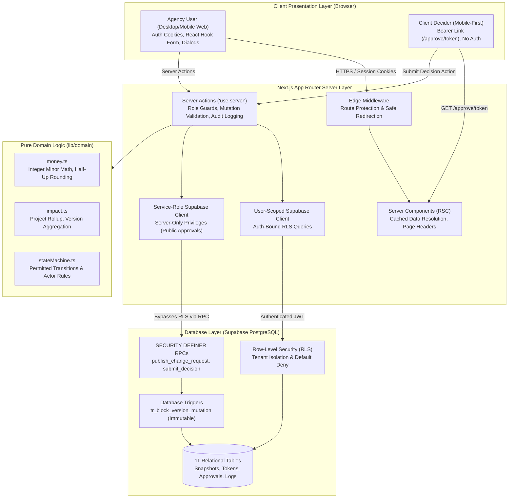
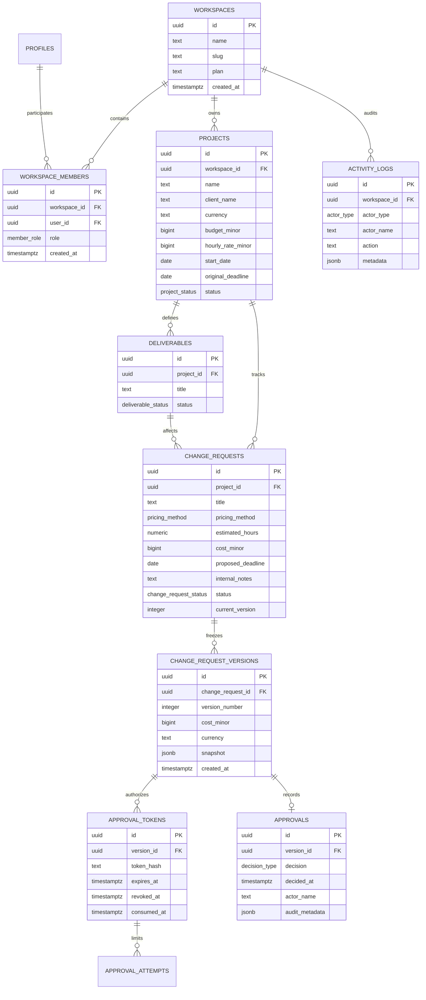
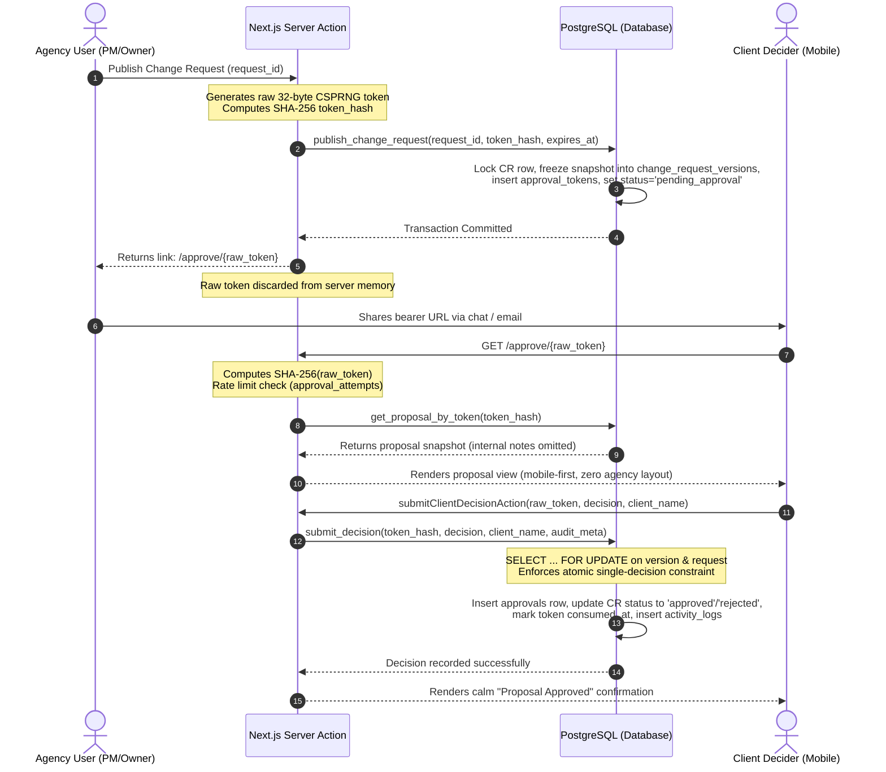

# ScopeGuard System Architecture & Technical Specifications

This document details the architectural topology, database schema, data flows, and security boundaries implemented in ScopeGuard.

---

## 1. High-Level System Architecture

ScopeGuard enforces strict layer separation between client views, Next.js server actions, pure business domain calculations, and PostgreSQL row-level security.

---

## 2. Entity-Relationship (ER) Diagram

ScopeGuard's database model decouples the mutable working draft from the immutable version snapshots that drive historical analytics.

---

## 3. Public Approval Sequence Diagram

The approval flow ensures cryptographic secret isolation, atomic locking against race conditions, and complete immutability.

---

## 4. Key Architectural Safeguards

1. **Calculations in Pure Domain:**
   - Calculations (`calculateHourlyCost`, `calculateProjectRollup`) reside in `lib/domain` with 0 external dependencies.
   - 100% covered by unit tests including floating point anomalies (`0.1 + 0.2`), boundary rounding, and zero-hour requests.
2. **Snapshot-Driven Rollups:**
   - Financial totals and dashboard metrics are computed strictly from immutable `change_request_versions` where an associated `approvals` record has `decision = 'approved'`.
   - Editing or modifying draft fields on a change request has 0 impact on contract value totals.
3. **Database-Level Immutability:**
   - Database trigger `tr_block_version_mutation` prevents any `UPDATE` or `DELETE` on `change_request_versions`.
   - Table constraint `uq_change_request_version` enforces unique version numbers per request.
   - Constraint `approvals_version_id_key` enforces exactly one recorded decision per version snapshot.

