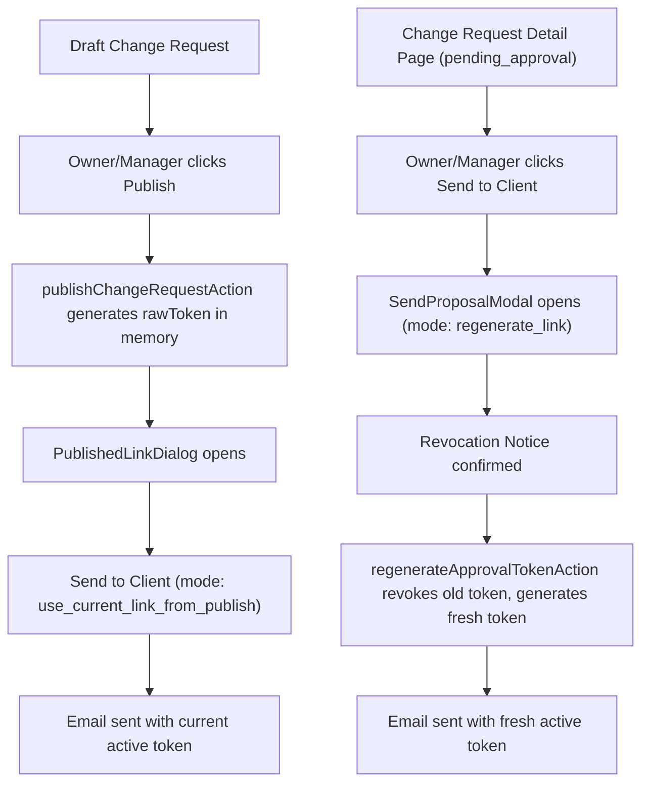

# Send to Client — Technical Architecture & Operating Manual

## 1. Feature Overview

ScopeGuard provides agency owners and project managers with a native **"Send to Client"** workflow. From any published (`pending_approval`) scope change request, agency leads can dispatch a professionally formatted, responsive transactional email directly to client stakeholders.

The email includes:
- Clear project context and workspace identity.
- Exact proposal scope summary and commercial terms (cost and timeline adjustment).
- Optional personal note from the sender (ephemeral, up to 500 characters).
- Bulletproof CTA button linking directly to the tokenized approval portal (`/approve/[token]`).
- Clean fallback approval URL.
- Expiration notice (14 days from generation).
- Direct `Reply-To` directed to the sender's authenticated email address.

Every send attempt is atomically rate-limited, logged to an immutable delivery log (`proposal_emails`), and reflected in the workspace audit activity feed.

---

## 2. Absolute Security & Access Boundaries

Adhering strictly to ScopeGuard Engineering Rules (`AGENTS.md`) and Security Architecture (`docs/DECISIONS.md`), the implementation enforces the following non-negotiable guarantees:

### 2.1 Cryptographic Token Isolation
- **Raw Bearer Tokens in Volatile Memory Only:** Approval tokens are generated on the server using `crypto.randomBytes(32)` (256 bits entropy) and encoded in URL-safe base64url characters.
- **No Token Plaintext Storage:** Raw tokens exist solely in volatile memory during generation and in the immediate server action response. Raw tokens are **never** stored in the database, **never** written to server logs, and **never** stored in delivery records or activity metadata.
- **SHA-256 Hashes Only:** The database (`approval_tokens`) persists only the 64-character lowercase hexadecimal SHA-256 hash (`token_hash`). A lost link cannot be retrieved from the database; it must be regenerated.

### 2.2 PII Protection & Email Masking
- **Audit Logs:** Activity logs (`activity_logs`) store recipient emails strictly in masked format (`c***@client.com`), hiding client personal identifiers while preserving domain context for agency operators.
- **Delivery Log:** The delivery history UI (`proposal_emails`) displays masked recipient addresses to workspace operators.

### 2.3 Ephemeral Personal Notes
- **Zero Database Persistence:** Personal notes entered by the sender are sent in the email body and are **never** stored in `proposal_emails` or any database table.
- **Metadata Flag Only:** The database stores only a boolean flag `personal_note_present: true/false`.
- **Sanitization:** Personal notes are capped at 500 characters and strictly validated to reject HTML tags (`<...>` regex) to eliminate phishing or styling injection.

### 2.4 Confidential Information Exemption
- **Zero Internal Notes:** Internal agency notes (`internal_notes`) and internal margin calculations are **never** included in emails, email templates, or client review pages.
- **Strict Escaping:** All dynamic values (names, titles, descriptions, amounts) are HTML-escaped using `escapeHtml` to prevent cross-site scripting (XSS) in email clients.

### 2.5 Role-Based Access Control (RLS & Procedures)
- **Role Permissions:**
  - **Owner & Manager:** Full authority to send proposals, configure client contacts, view delivery history, and revoke tokens.
  - **Member:** Strictly forbidden from sending proposals or viewing delivery logs.
  - **Public / Anon:** Direct API execution and read access denied.
- **Row-Level Security (RLS):** Default deny enabled on `proposal_emails`. Client-side direct INSERT, UPDATE, and DELETE are completely blocked. SELECT is permitted only for authenticated owners and managers of the parent workspace.
- **Fixed `search_path`:** All `SECURITY DEFINER` functions specify `search_path = public, pg_temp` to prevent hijacking.

---

## 3. Rate Limiting & Cooldown Engine

To prevent email spamming, provider abuse, and accidental multiple clicks, two layers of atomic rate limiting are enforced in PostgreSQL:

1. **60-Second Cooldown:** A minimum of 60 seconds must elapse between consecutive send attempts for the same change request.
2. **Hourly Cap:** A maximum of 5 email send attempts are permitted per change request per hour.
3. **Send Attempt Key (Idempotency):** Every send modal session generates a unique `attemptKey`. If an identical attempt key is submitted, the stored record is returned without re-queuing duplicates.

Violations of cooldown or rate limits throw immediate, plain-language error messages in the UI.

---

## 4. Dual Send Workflows

The system supports two complementary send modes depending on where the user initiates the action:

### 4.1 Mode 1: Immediate Send on Publish (`use_current_link_from_publish`)
- Triggered directly from `PublishedLinkDialog` right after a proposal is published.
- Utilizes the in-memory `rawToken` returned in the response of `publishChangeRequestAction`.
- Does not regenerate or invalidate the token; uses the single active token issued at publish time.

### 4.2 Mode 2: Send from Change Request Detail (`regenerate_link`)
- Triggered from the pending workflow bar on `/changes/[id]`.
- Because raw tokens cannot be retrieved from the database, sending from this view calls `regenerateApprovalTokenAction`, generating a fresh 32-byte token and immediately revoking any previously shared links.
- The UI displays an explicit amber banner warning the user that previously shared links will become invalid.

---

## 5. Honest Status Handling

ScopeGuard never claims knowledge it does not possess. The application reports honest delivery states:

| Status | Label | Description |
| :--- | :--- | :--- |
| `sent` | **Sent** | The transactional email provider (Resend) accepted the message for delivery (`messageId` recorded). Does not claim "delivered" or "read". |
| `not_configured` | **Not Configured** | `RESEND_API_KEY` is missing or placeholder. The UI informs the user honestly and provides the active link to copy manually. |
| `failed` | **Failed** | The provider rejected the message (e.g. invalid domain, rate limit). The UI displays the provider error code and offers the copyable approval link. |

---

## 6. Primary Client Contact on Projects

Projects now feature dedicated client contact fields:
- `client_contact_name`: String (up to 100 characters, optional).
- `client_contact_email`: Valid email (up to 255 characters, optional).

### Where it appears:
1. **Project Settings (`/projects/[id]/settings`):** Editable inputs in `ProjectSettingsForm`.
2. **Project Overview (`/projects/[id]`):** Displayed in the "Contract Baseline" card with a link to configure if empty.
3. **Send Proposal Modal:** Pre-fills recipient email and name automatically. The modal includes a checkbox to "Save recipient as primary client contact for this project".

